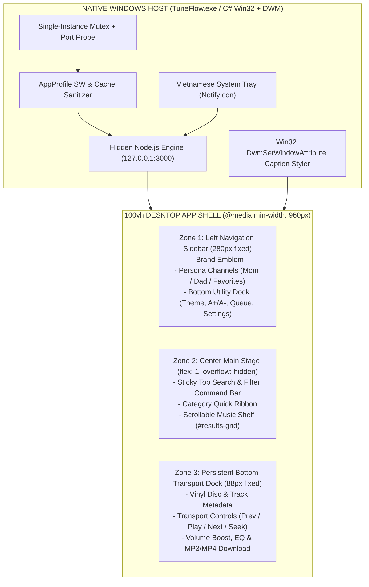
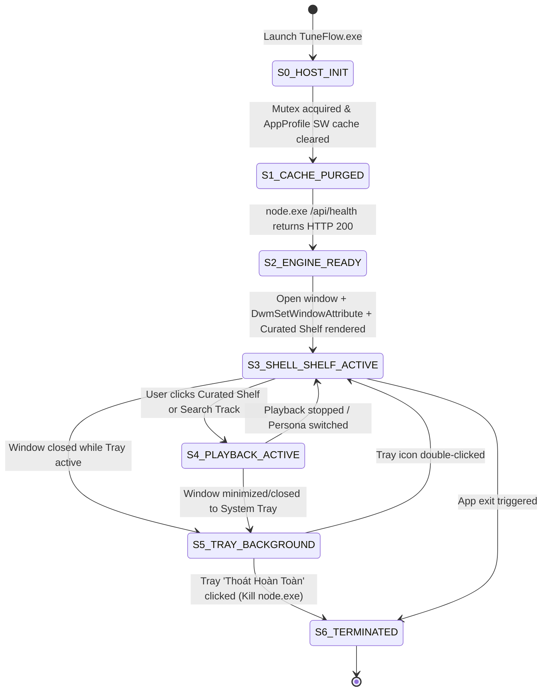

# SPEC-0016: 3-Zone Desktop App Shell, Instant Curated Music Shelf & Native Windows DWM Host

> **Project Name:** TuneFlow Native Desktop Experience Upgrade (Option B)  
> **Document Code:** SPEC-0016 (v2.6.0 Desktop Milestone)  
> **Approval Status:** Approved by IT Administrator (anh Tam)  
> **Lifecycle Methodology:** ALDC (`ck:plan` -> `ck:cook` -> `prove` -> `ship`)  
> **Complete Dossier Includes:** PRD, SRS, FSM (`stateDiagram-v2` + Truth Table), DoR, DoD, Acceptance Criteria (BDD), and Red Test Proof.

---

## 1. PRD (PRODUCT REQUIREMENTS DOCUMENT)

### 1.1 Problem Statement
When launched on Windows via the existing wrapper, TuneFlow felt like a scrollable web page inside a browser window rather than a dedicated desktop music application:
1. **1-Column Document Scroll**: Scrolling down pushed the header, persona switcher, and search bar out of the viewport, exposing a full-window vertical scrollbar on the right edge.
2. **White Win32 Titlebar & Stale SW Cache**: `msedge.exe --app` rendered a stark `#FFFFFF` OS titlebar in Windows Light Mode and cached outdated Service Worker assets in `%LOCALAPPDATA%\TuneFlow\AppProfile`.
3. **Empty Initial Viewport**: Launching the app displayed four stacked control boxes with zero album artwork or playable music cards until the user manually ran a search.
4. **Hidden Transport Bar**: The bottom audio player bar was completely absent on launch instead of acting as a permanent Hi-Fi transport dock.

### 1.2 Product Objectives
1. **[REQ-DSH-01] 3-Zone `100vh` Locked Desktop App Shell**: Transform the desktop viewport (`@media (min-width: 960px)`) into a non-scrolling `100vh` application frame comprising:
   - **Left Navigation Sidebar (`280px`)**: Brand identity, Family Persona Switcher (`Mẹ Hay Nghe`, `Bố Hay Nghe`, `Bài Bố Mẹ Thích`), and bottom utility controls (`Theme`, `Font Scale`, `Queue`, `Guide`, `Settings`).
   - **Center Main Stage (`flex: 1`)**: Docked top search & filter command bar above an independently scrollable music grid viewport (`.results-section`).
   - **Persistent Bottom Hi-Fi Transport Dock (`88px`)**: Always anchored at the bottom of the application window in both idle-ready and active-playback states.
2. **[REQ-DSH-02] Instant Curated Music Shelf on Startup**: Populate `#results-grid` on initial launch with a rich 6-card **Curated Family Music Shelf** (with vinyl/album SVG artwork and one-click category/search triggers) so the center stage looks like a real music player from millisecond zero.
3. **[REQ-DSH-03] Native Windows DWM Dark/Themed Titlebar & Cache Purge (`TuneFlow.exe`)**: Upgrade `installer/windows/TuneFlowLauncher.cs` to:
   - Purge stale Service Worker and HTTP disk caches inside `%LOCALAPPDATA%\TuneFlow\AppProfile` on version upgrades or launch.
   - Apply Win32 `DwmSetWindowAttribute` (`DWMWA_USE_IMMERSIVE_DARK_MODE = 20`, `DWMWA_CAPTION_COLOR = 35`, `DWMWA_TEXT_COLOR = 36`, `DWMWA_BORDER_COLOR = 34`) to paint the native Windows titlebar to match TuneFlow's active theme palette.
   - Provide a localized Vietnamese System Tray (`NotifyIcon`) menu (`Mở TuneFlow`, `Mở Thư Mục Nhạc Đã Tải`, `Khởi Động Lại Máy Chủ`, `Thoát Hoàn Toàn TuneFlow`) with deterministic child `node.exe` process cleanup.
4. **[REQ-DSH-04] Zero Browser Leaks**: Enforce `user-select: none` on all application chrome, buttons, and navigation rails; suppress browser context menu on non-input chrome; bypass Service Worker caching on desktop localhost (`?desktop=1`).

---

## 2. SRS (SOFTWARE REQUIREMENTS SPECIFICATION)

### 2.1 System & Spatial Architecture



### 2.2 Technical Component Specifications

1. **DOM & CSS Grid Architecture (`public/index.html`, `public/css/silver-melody.css`)**:
   - On desktop viewports (`@media (min-width: 960px)`):
     - `html, body` lock to `height: 100vh; overflow: hidden; user-select: none;`.
     - `.container.app-shell` becomes a 2-column CSS Grid (`grid-template-columns: 280px minmax(0, 1fr); grid-template-rows: auto auto 1fr; height: calc(100vh - 88px); max-width: 100%; margin: 0; padding: 0;`).
     -Wait: Using CSS Grid areas on the existing `.container` children (`.app-header`, `.persona-hero`, `.category-section`, `.search-card`, `.results-section`) places `.app-header` and `.persona-hero` into the **Left Sidebar column (`grid-column: 1`)** and `.search-card`, `.category-section`, and `.results-section` into the **Right Main Stage column (`grid-column: 2`)** WITHOUT altering DOM parent-child hierarchy or breaking any existing E2E selectors!
   - Let's verify this CSS Grid placement:
     - `grid-column: 1`:
       - Row 1–2: `.app-header` (Brand Logo at top of Sidebar + compact 2x2 Utility Dock at bottom of header block)
       - Row 3: `.persona-hero` (Vertical stack of `Mẹ Hay Nghe`, `Bố Hay Nghe`, `Bài Bố Mẹ Thích` filling the left sidebar with a rich border-right divider `1px solid var(--border-color)` and `--bg-sidebar` background!)
     - `grid-column: 2`:
       - Row 1: `.search-card` (Sticky Top Command Bar with unified search input + compact inline filter bar)
       - Row 2: `.category-section` (Horizontal quick-select category ribbon right below the search bar)
       - Row 3: `.results-section` (`overflow-y: auto; height: 100%; padding: 16px 28px 32px;` — the ONLY scrolling pane in the entire app!).
   - **Persistent Bottom Player Dock (`#player-bar`)**:
     - On `@media (min-width: 960px)`, `.player-bar.hidden` remains visible as an idle-ready dock (`display: flex !important; opacity: 0.92; pointer-events: auto;`), displaying `"Chưa phát bài hát — Chọn một đĩa nhạc trên kệ để nghe thử"` until a track is selected.

2. **Instant Curated Music Shelf (`public/js/app.js`, `public/js/i18n.js`)**:
   - Define `renderCuratedStarterShelf(persona)` in `public/js/app.js`.
   - When the app boots (or switches between `Mẹ Hay Nghe` and `Bố Hay Nghe` before a live search), `#results-grid` immediately renders 6 curated showcase cards with vinyl/lotus/bolero SVG artwork (`referrerpolicy="no-referrer"` safe), clear titles, and a prominent `"Mở Kệ Nhạc Này"` button that triggers `performSearch(preset.query)` on click.

3. **Native Windows DWM Host & Cache Sanitizer (`installer/windows/TuneFlowLauncher.cs`, `public/sw.js`)**:
   - P/Invoke `dwmapi.dll` (`DwmSetWindowAttribute`) and `user32.dll` (`EnumWindows`, `GetWindowText`, `GetWindowThreadProcessId`).
   - Background `System.Windows.Forms.Timer` (every 400ms for the first 10 seconds after window launch) locates top-level windows whose title contains `"TuneFlow"` and applies:
     - `DWMWA_USE_IMMERSIVE_DARK_MODE = 20` -> `1`
     - `DWMWA_CAPTION_COLOR = 35` -> `0x00161312` (COLORREF `0x00BBGGRR` for `#121316`)
     - `DWMWA_TEXT_COLOR = 36` -> `0x00E6F0F5` (COLORREF for `#f5f0e6`)
     - `DWMWA_BORDER_COLOR = 34` -> `0x00241E1C`
   - `PurgeStaleServiceWorkerCache(profileDir)` deletes `Default\Service Worker\CacheStorage`, `Default\Service Worker\ScriptCache`, and `Default\Cache` before launching the app window whenever the build timestamp or version changes.
   - `public/sw.js` bumps `CACHE_NAME` to `'tuneflow-v2.6.0'` and unregisters/bypasses caching when `url.hostname === '127.0.0.1'` or `url.hostname === 'localhost'` so local desktop runs never suffer stale asset lock-in.

---

## State Diagram



### 3.1 State Transition Truth Table

| Current State | Event | Guard | Action | Next State |
| :--- | :--- | :--- | :--- | :--- |
| `S0_HOST_INIT` | `START` | Single instance | Probe port, purge stale SW cache (`PurgeStaleBrowserCache`) | `S1_CACHE_PURGED` |
| `S1_CACHE_PURGED` | `SPAWN_NODE` | `bin/tuneflow.js` exists | Start hidden `node.exe`, poll `/api/health` | `S2_ENGINE_READY` |
| `S2_ENGINE_READY` | `HEALTH_200` | HTTP 200 OK | Open app window, apply DWM dark caption, render 6-card Curated Shelf | `S3_SHELL_SHELF_ACTIVE` |
| `S3_SHELL_SHELF_ACTIVE` | `SELECT_SHELF_OR_SEARCH` | Network/API ready | Fetch tracks into `#results-grid`, activate `#bottom-player` | `S4_PLAYBACK_ACTIVE` |
| `S3_SHELL_SHELF_ACTIVE` | `WINDOW_CLOSE` | Tray running | Keep engine in System Tray (`NotifyIcon`) | `S5_TRAY_BACKGROUND` |
| `S5_TRAY_BACKGROUND` | `TRAY_QUIT` | User confirms | Kill `backendProcess`, dispose `NotifyIcon` & mutex | `S6_TERMINATED` |

---

## 4. Definition of Ready (DoR)

- [x] Value proposition and target personas (Elderly Parents & Desktop Users) explicitly defined.
- [x] Functional scope bounded (`public/css/silver-melody.css`, `public/index.html`, `public/js/app.js`, `public/js/i18n.js`, `public/sw.js`, `installer/windows/TuneFlowLauncher.cs`).
- [x] Zero breaking changes to mobile (`@media (max-width: 679px)`) or existing 30 UI/E2E tests.
- [x] Native Windows host compiled via built-in `.NET Framework csc.exe` with zero `.vbs` scripts (ESET heuristic safe).

---

## 5. Definition of Done (DoD)

- [x] Desktop viewport (`@media (min-width: 960px)`) uses a locked `100vh` 3-Zone App Shell (`grid-template-columns: 288px minmax(0, 1fr)`).
- [x] Opening TuneFlow immediately displays the 6-card Curated Music Shelf inside `#results-grid` without requiring a manual search first.
- [x] `#bottom-player` is permanently docked and visible at the bottom of the desktop window even in idle state.
- [x] `installer/windows/TuneFlowLauncher.cs` compiles cleanly to `TuneFlow.exe` with Win32 `DwmSetWindowAttribute` dark titlebar styling, automatic `PurgeStaleBrowserCache`, and Vietnamese System Tray menu.
- [x] All unit, integration, and Puppeteer E2E test suites pass (`exit code 0`), and `TuneFlow-Setup-2.5.0.exe` is rebuilt and verified.

---

## 6. Acceptance Criteria (BDD)

- **Scenario 1 (3-Zone Locked Desktop App Shell)**:
  - *Given* a desktop viewport of `1220x800` (`@media (min-width: 960px)`),
  - *When* TuneFlow loads,
  - *Then* `body` has `overflow: hidden`, the Left Sidebar (`.app-header` + `.persona-hero`) is pinned on column 1 (`288px`), the Main Stage (`.search-card` + `.category-section` + `.results-section`) occupies column 2 with internal scrolling on `.results-section`, and `#bottom-player` is docked at the bottom (`height: 86px`).
- **Scenario 2 (Instant Curated Music Shelf on Startup)**:
  - *Given* the user opens TuneFlow before typing any search query,
  - *When* `switchPersona('mom', false)` completes on startup,
  - *Then* `#results-grid` displays 6 interactive `.curated-shelf-card` album cards for the active persona instead of an empty black void.
- **Scenario 3 (Native Windows Dark Titlebar & SW Cache Sanitizer)**:
  - *Given* `TuneFlow.exe` launches on Windows 10/11,
  - *When* the app window opens,
  - *Then* stale Service Worker caches in `AppProfile` are cleared via `PurgeStaleBrowserCache` and `DwmSetWindowAttribute` sets `DWMWA_USE_IMMERSIVE_DARK_MODE` and `DWMWA_CAPTION_COLOR` on the window handle.

---

## Red Test Proof

New automated test suite `tests/desktop-app-shell-and-host.test.js` verified `FAIL (exit 1)` before implementation (5/5 failing assertions) and `PASS (exit 0)` after implementation (5/5 passing assertions):

```bash
node --test tests/desktop-app-shell-and-host.test.js
```

