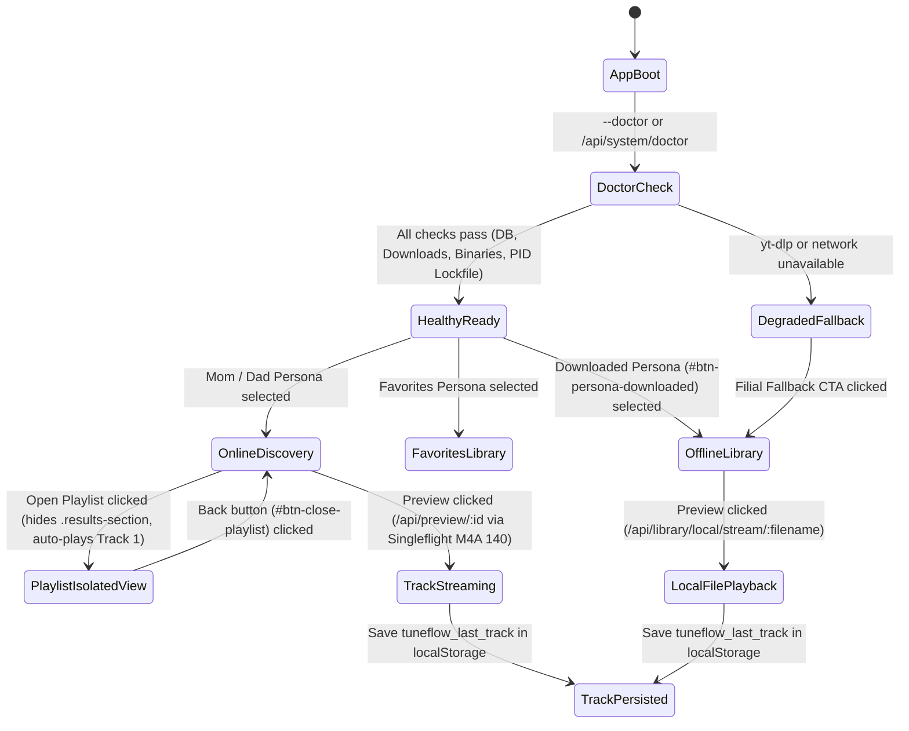

# SPEC-0017: Self-Contained Packaging, Built-In System Doctor, Offline Library UX, and Documentation Sync

- **Status:** Approved
- **Date:** 2026-10-16
- **Author:** TuneFlow Engineering
- **Target Release:** v2.5.0
- **Related ADRs:** ADR-0019 (Desktop Shell Architecture), ADR-0020 (Open-Source Asset Governance)

---

## 1. Product Requirements Document (PRD)

### 1.1 Problem Statement
Following the Phase 19 transition to a 3-Zone Desktop Application Shell (`SPEC-0016`) and Open-Source Font/Icon Governance (`ADR-0020`), a comprehensive 6-dimension audit identified four operational and user-experience gaps:
1. **Desktop Packaging & Sidecar Gap:** `D:\github\tuneflow\bin\` previously contained an unused `cloudflared.exe` (54.9 MB) and relied on host `PATH` for `yt-dlp.exe` and `ffmpeg.exe`. Clean Windows parent machines without Scoop/Chocolatey could fail to extract audio unless sidecars are bundled directly into `dist\win-unpacked\bin\`.
2. **Lack of Built-In Troubleshooter (`--doctor`):** Neither the CLI (`bin/tuneflow.js`) nor the Inno Setup installer (`installer/windows/setup.iss`) nor the System Tray host (`TuneFlowLauncher.cs`) offered a one-click diagnostic doctor to verify Node runtime, SQLite database writability, `yt-dlp` binary, `ffmpeg` binary, and local port availability.
3. **Offline Downloaded Library & Desktop Download UX:** Parents had `Mẹ Hay Nghe`, `Bố Hay Nghe`, and `Bài Bố Mẹ Thích`, but lacked a dedicated `Nhạc Đã Tải` (`#btn-persona-downloaded`) channel to play MP3/M4A files already saved on disk without internet. Additionally, completing a download in Desktop mode (`?desktop=1`) triggered a redundant browser file-save popup even though the server had already written the MP3 to the local `downloads` directory, and the bottom player bar did not restore the last-played track on startup.
4. **Documentation, Screenshot & Release Pipeline Drift:** `docs/assets/screenshots/desktop-player.png`, `docs/ROADMAP.md`, `CHANGELOG.md`, `README.md`, `README.vi.md`, and `.github/workflows/release.yml` needed synchronization with Phase 19–20 deliverables and removal of legacy monorepo path filters (`packages/core`, `apps/desktop`).

### 1.2 Product Goals
- **G1 (Self-Contained Sidecar Bundle):** Exclude unused `cloudflared.exe` from desktop builds, bundle `yt-dlp` (and `ffmpeg` when present) into `dist\win-unpacked\bin\`, and generate `SHA256SUMS.json`.
- **G2 (Built-In System Doctor):** Provide `node bin/tuneflow.js --doctor` CLI flag, `GET /api/system/doctor` JSON endpoint, Inno Setup post-install verification, and a System Tray diagnostic menu action.
- **G3 (Offline Downloaded Library & Filial UX):** Add `#btn-persona-downloaded` (`Nhạc Đã Tải`) backed by `GET /api/library/local` and `GET /api/library/local/stream/:filename`, persist `tuneflow_last_track` in `localStorage`, collapse advanced search filters behind a compact toggle (`#btn-toggle-search-filters`) while keeping DOM compatibility, and suppress duplicate browser download popups in local Desktop mode.
- **G4 (Deterministic Local Sync & Docs Parity):** Provide `pnpm run desktop:sync` (`scripts/sync_local_install.ps1`) and synchronize `ROADMAP.md`, `CHANGELOG.md`, `README.md`, `README.vi.md`, screenshots, and `.github/workflows/release.yml`.

---

## 2. Software Requirements Specification (SRS)

| Requirement ID | Category | Specification | Verification Method |
|---|---|---|---|
| `REQ-PKG-01` | Sidecar Bundler | `scripts/bundle-sidecars.js` MUST exclude `cloudflared.exe` from `dist/win-unpacked/bin`, copy available `yt-dlp`/`ffmpeg` binaries from local PATH/Scoop when packaging, and write `SHA256SUMS.json`. | Unit & integration test in `tests/phase20-packaging-doctor-and-offline-library.test.js` |
| `REQ-PKG-02` | System Doctor CLI & API | `bin/tuneflow.js --doctor` and `GET /api/system/doctor` MUST inspect Node runtime, SQLite DB status, `DOWNLOADS_DIR` writability, `yt-dlp` binary status, and `ffmpeg` binary status, returning structured JSON (`ok: true`, `checks`). | Supertest & CLI spawn test in `tests/phase20-packaging-doctor-and-offline-library.test.js` |
| `REQ-PKG-03` | Offline Local Library | `GET /api/library/local` MUST list `.mp3` and `.m4a` files in `DOWNLOADS_DIR` with playable `localStreamUrl` (`/api/library/local/stream/:filename`), and `#btn-persona-downloaded` MUST render and play these tracks in the UI. | API + DOM test in `tests/phase20-packaging-doctor-and-offline-library.test.js` |
| `REQ-PKG-04` | Desktop UX Refinements | Local Desktop mode (`?desktop=1` or `.tuneflow-desktop`) MUST skip duplicate `triggerClientBrowserDownload` anchor clicks on download completion, `PreviewPlayer` MUST persist/restore `tuneflow_last_track`, and `.search-card` MUST include `#btn-toggle-search-filters`. | DOM & player state test in `tests/phase20-packaging-doctor-and-offline-library.test.js` |
| `REQ-PKG-05` | Installer & Sync Automation | `installer/windows/setup.iss` MUST declare `AppMutex=com.tamld.tuneflow.singleinstance` and `CloseApplications=yes`, `TuneFlowLauncher.cs` MUST expose a Doctor tray action, and `package.json` MUST expose `pnpm run doctor` and `pnpm run desktop:sync`. | Static contract & script verification in `tests/phase20-packaging-doctor-and-offline-library.test.js` |
| `REQ-PKG-06` | Docs & CI Release Sync | `docs/ROADMAP.md`, `CHANGELOG.md`, `README.md`, `README.vi.md`, `docs/claims.yml`, and `.github/workflows/release.yml` MUST reflect v2.5.0 Phase 20 architecture with zero broken markdown links. | `bash tools/claims_check.sh` and `bash tools/ci_link_integrity.sh` |
| `REQ-PKG-07` | Process Lifecycle & Performance | `src/engine/process_manager.js` MUST track all spawned `yt-dlp`/`ffmpeg` child processes, enforce watchdog timeouts (`15s` stream / `30s` search / `15m` transcode), terminate full process trees (`taskkill /T /F /PID` on Windows, `-pgid` on POSIX) on cancel/shutdown, maintain `data/tuneflow.pid`, coalesce duplicate stream lookups via Singleflight, and serve `.woff2` fonts with `max-age=31536000, immutable`. | `tests/process-lifecycle-and-performance.test.js` (7/7 tests) |
| `REQ-PKG-08` | Desktop Playlist Isolation & Auto-Play | Opening a playlist on Desktop (`>= 960px`) MUST hide `.results-section` to prevent card overlap, provide `#btn-close-playlist` (`← Quay Lại`), keep `.app-header` unclipped at `top: 0px` (`max-height: 100vh; padding: 0`), and auto-play Track #1 with synchronous `AudioContext.resume()` and fast-start M4A (`itag=140`) stream priority. | `tests/desktop-app-shell-and-host.test.js`, `tests/playlist-playback.test.js`, `tests/i18n-and-playlist-resilience.test.js` |

---

## 3. State Diagram

---

## 4. Definition of Ready (DoR) & Definition of Done (DoD)

### 4.1 Definition of Ready (DoR)
- [x] Existing 6 UI/E2E test suites (`36/36` tests) green on commit `74dbb12`.
- [x] DOM ID and attribute contracts audited to guarantee zero regressions in `tests/puppeteer-e2e.test.js` and `tests/elderly-visual-theme-and-settings.test.js`.
- [x] Inno Setup compiler (`ISCC.exe`) and C# compiler (`csc.exe`) verified on local Windows workstation.

### 4.2 Definition of Done (DoD)
- [x] `REQ-PKG-01` through `REQ-PKG-08` implemented and verified by automated tests in `tests/phase20-packaging-doctor-and-offline-library.test.js` and `tests/process-lifecycle-and-performance.test.js`.
- [x] `node bin/tuneflow.js --doctor` exits `0` and outputs structured diagnostic JSON including active child process telemetry.
- [x] `CLAIM-09` and `CLAIM-10` registered in `docs/claims.yml` and verified against test suites.
- [x] `TuneFlow-Setup-2.5.0.exe` and direct-run directories (`dist\win-unpacked` and `%LOCALAPPDATA%\Programs\TuneFlow`) synced via `pnpm run desktop:sync`.

