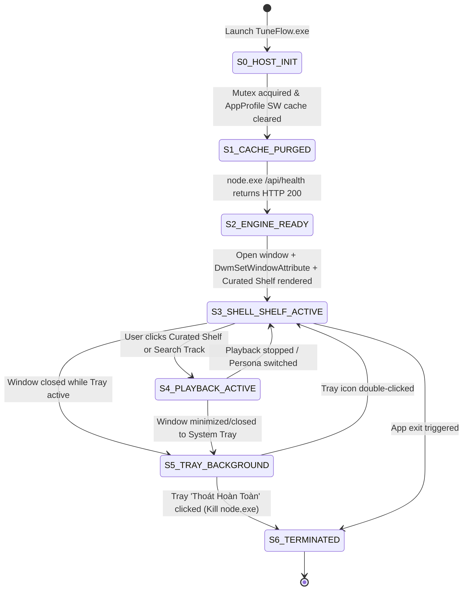

# Implementation Plan: Option B — Native Desktop App Shell & DWM Host (`SPEC-0016`)

## 1. Objective & Scope
Transform TuneFlow from a 1-column scrolling web page in a browser frame into a genuine **3-Zone `100vh` Desktop Music Application** with:
1. **3-Zone Locked Desktop App Shell (`@media (min-width: 960px)`)**:
   - **Left Navigation Sidebar (`288px`)**: Brand identity, Family Persona Channels (`Mẹ Hay Nghe`, `Bố Hay Nghe`, `Bài Bố Mẹ Thích`), and bottom utility controls (`Theme`, `Font Scale`, `Queue`, `Guide`, `Settings`).
   - **Center Main Stage (`flex: 1`)**: Sticky Top Search & Filter Command Bar + Category Quick Ribbon + Independently Scrollable Music Shelf (`.results-section`).
   - **Persistent Bottom Hi-Fi Transport Dock (`#player-bar`, `88px`)**: Permanently docked at the bottom of the desktop window even in idle-ready state.
2. **Instant Curated Music Shelf (`renderCuratedStarterShelf`)**:
   - Render 6 rich curated album/playlist cards immediately on launch and persona switch so the main stage is populated with music artwork from millisecond zero.
3. **Native Windows Host Upgrade (`installer/windows/TuneFlowLauncher.cs` + `public/sw.js`)**:
   - Purge stale Service Worker and HTTP cache inside `%LOCALAPPDATA%\TuneFlow\AppProfile` on startup.
   - Apply Win32 `DwmSetWindowAttribute` (`DWMWA_USE_IMMERSIVE_DARK_MODE = 20`, `DWMWA_CAPTION_COLOR = 35`, `DWMWA_TEXT_COLOR = 36`, `DWMWA_BORDER_COLOR = 34`) to paint the native Windows titlebar deep obsidian (`#121316`) instead of stark white (`#FFFFFF`).
   - Localize the System Tray (`NotifyIcon`) context menu to Vietnamese and ensure deterministic `node.exe` daemon termination on exit.

## 2. Multi-Tier Worker Orchestration (`F0` Supervisor -> `F1` `g8s` Workers + `F2` Subagents)

| Tier & Worker | Role | Target Files | Verification Oracle |
| :--- | :--- | :--- | :--- |
| **F1 Scout Wave (`g8s`)** | `scout` (`read_only`) | `public/index.html`, `public/css/silver-melody.css`, `public/js/app.js`, `installer/windows/TuneFlowLauncher.cs` | 3/3 receipts completed (`27171b25`, `4ffd000f`, `412af81c`) |
| **Phase 1: Red Test Suite (TDD)** | `F0` / `F1` | `tests/desktop-app-shell-and-host.test.js` | Fails (`exit 1`) before implementation, passes (`exit 0`) after |
| **Phase 2: 3-Zone App Shell CSS & Persistent Dock** | `F1` / `F0` | `public/css/silver-melody.css` | Desktop Grid (`grid-template-columns: 288px minmax(0, 1fr)`), `100vh` lock, persistent `#player-bar` |
| **Phase 3: Instant Curated Shelf & SW Bypass** | `F1` / `F0` | `public/js/app.js`, `public/js/i18n.js`, `public/sw.js`, `public/index.html` | 6 `.curated-shelf-card` items rendered on boot; SW bypass on `127.0.0.1`/`localhost` |
| **Phase 4: Native Windows DWM Host & Packaging** | `F1` / `F0` | `installer/windows/TuneFlowLauncher.cs`, `src/desktop/launcher.js`, `scripts/package_windows.ps1` | `csc.exe` compiles `TuneFlow.exe` with `DwmSetWindowAttribute` + SW cache sanitizer; `ISCC.exe` builds `TuneFlow-Setup-2.5.0.exe` |

## State Diagram



## Red Test Proof

Red-to-Green verification suite `tests/desktop-app-shell-and-host.test.js` (`FAIL exit 1 -> PASS exit 0`):

```bash
node --test tests/desktop-app-shell-and-host.test.js
```
