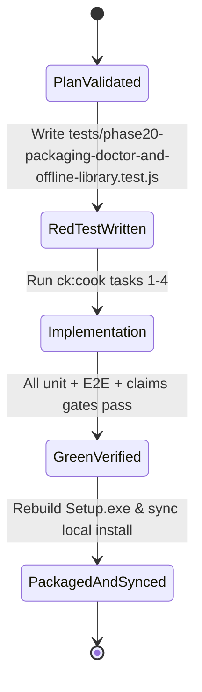

# Implementation Plan: Phase 20 Self-Contained Packaging, System Doctor, Offline Library UX & Docs Sync

- **Spec Reference:** `docs/spec/SPEC-0017-self-contained-packaging-doctor-and-ux-refinement.md`
- **Date:** 2026-10-16
- **Branch:** `master`

---

## 1. Architecture & Execution Phases

### Phase 1: System Doctor CLI/API & Offline Local Library (`REQ-PKG-02`, `REQ-PKG-03`)
1. Update `bin/tuneflow.js` to support `--doctor`:
   - Inspects Node version, SQLite DB initialization, `DOWNLOADS_DIR` writability, `yt-dlp` binary resolution, and `ffmpeg` availability.
   - Writes report to `%LOCALAPPDATA%\TuneFlow\logs\doctor.json` (when `LOCALAPPDATA` is set) and prints JSON to stdout.
2. Update `src/routes/api.js`:
   - Add `GET /api/system/doctor` returning `{ ok: true, success: true, status, checks, timestamp }`.
   - Add `GET /api/library/local` returning downloaded `.mp3` / `.m4a` tracks in `DOWNLOADS_DIR` sorted by newest modification time (`mtimeMs`), formatted as standard TuneFlow track objects with `isLocalDownloaded: true`, `filename`, and `localStreamUrl: '/api/library/local/stream/' + encodeURIComponent(filename)`.
   - Add `GET /api/library/local/stream/:filename` with strict `path.basename` traversal guard and byte-range streaming via `res.sendFile`.

### Phase 2: Sidecar Bundler, Inno Setup Mutex & Local Sync Script (`REQ-PKG-01`, `REQ-PKG-05`)
1. Create `scripts/bundle-sidecars.js`:
   - Removes any accidental `cloudflared.exe` from target `dist/win-unpacked/bin`.
   - Copies `yt-dlp.exe` and `ffmpeg.exe` from `bin/` or resolved system/Scoop paths into `dist/win-unpacked/bin` when available.
   - Generates `SHA256SUMS.json` for all bundled binaries in the target directory.
2. Update `scripts/package_windows.ps1` to invoke `node scripts/bundle-sidecars.js` instead of copying raw `cloudflared.exe`.
3. Update `installer/windows/setup.iss` with `AppMutex=com.tamld.tuneflow.singleinstance` and `CloseApplications=yes`.
4. Update `installer/windows/TuneFlowLauncher.cs` to add `"Kiểm Tra Hệ Thống (Doctor)"` in the System Tray context menu (opening `/api/system/doctor` or running `--doctor`).
5. Create `scripts/sync_local_install.ps1` and wire `"doctor": "node bin/tuneflow.js --doctor"` and `"desktop:sync": "powershell -ExecutionPolicy Bypass -File scripts/sync_local_install.ps1"` in `package.json`.

### Phase 3: Frontend Offline Library Channel, Last-Track Persistence & Desktop UX (`REQ-PKG-03`, `REQ-PKG-04`)
1. Update `public/index.html`, `public/js/i18n.js`, `public/js/app.js`, and `public/css/silver-melody.css`:
   - Add `#btn-persona-downloaded` (`Nhạc Đã Tải (0)`) inside `.persona-hero`.
   - Implement `showDownloadedView()` and `refreshDownloadedCount()` in `public/js/app.js` fetching `GET /api/library/local`.
   - Add compact filter toggle button `#btn-toggle-search-filters` in `.search-card` to toggle `.search-filters-row.collapsed` cleanly while preserving DOM text for E2E tests.
   - In `triggerClientBrowserDownload(item)`, refresh the downloaded count and skip creating a redundant `<a download>` popup when running in Desktop App Shell mode (`window.location.search.includes('desktop=1')` or `document.documentElement.classList.contains('tuneflow-desktop')`).
2. Update `public/js/player.js`:
   - Support `track.localStreamUrl` in `playTrack(track)` so offline downloaded tracks stream directly from `/api/library/local/stream/:filename`.
   - Save `tuneflow_last_track` to `localStorage` on `playTrack(track)` and restore `this.currentTrack` + title in `PreviewPlayer` constructor when `tuneflow_last_track` is present.

### Phase 4: Documentation, Screenshots & CI Workflow Cleanup (`REQ-PKG-06`)
1. Regenerate `docs/assets/screenshots/desktop-player.png` from the live 3-Zone Desktop App Shell.
2. Update `docs/ROADMAP.md` (Phase 20 + `RM-48`..`RM-50`), `CHANGELOG.md`, `README.md`, `README.vi.md`, `docs/claims.yml` (`CLAIM-09`), and `.github/workflows/release.yml`.

---

## State Diagram

---

## Red Test Proof

Before or alongside implementation, `tests/phase20-packaging-doctor-and-offline-library.test.js` verifies:
1. `GET /api/system/doctor` returns HTTP 200 with `ok: true` and `checks` object (`node`, `database`, `downloadsDir`, `ytdlp`, `ffmpeg`).
2. `GET /api/library/local` lists local `.mp3` files and `GET /api/library/local/stream/:filename` streams audio bytes with path-traversal protection.
3. `node bin/tuneflow.js --doctor` exits `0` with valid JSON diagnostics.
4. `scripts/bundle-sidecars.js` excludes `cloudflared.exe` and writes `SHA256SUMS.json`.
5. `public/index.html`, `public/js/app.js`, and `public/js/player.js` expose `#btn-persona-downloaded`, `#btn-toggle-search-filters`, `localStreamUrl` playback, and `tuneflow_last_track` persistence.
